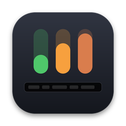

<p align="center">
  
</p>

<h1 align="center">Usage Touch Bar（加固版）</h1>

<p align="center">
  在 MacBook 的 Touch Bar 上实时显示 <b>Claude Code</b>、<b>Codex</b>、<b>OpenCode</b> 的用量额度。<br>
  基于 <a href="https://github.com/neelashkannan/usage-touchbar">neelashkannan/usage-touchbar</a> 二次开发：做了安全加固，加了中文图形设置、音乐 App 适配，并支持一键打包 DMG。
</p>

---

## 目录

- [功能](#功能)
- [安装](#安装)
- [设置](#设置)
- [音乐 App 适配](#音乐-app-适配)
- [安全说明](#安全说明)
- [从源码编译](#从源码编译)
- [命令行用法](#命令行用法)
- [配置文件](#配置文件)
- [卸载](#卸载)
- [已知限制](#已知限制)
- [贡献者](#贡献者)
- [许可](#许可)

## 功能

- **Touch Bar 实时用量**：显示每个服务的 5 小时额度和每周额度、重置倒计时、套餐（PRO / MAX），按用量用绿、橙、红变色。
- **Control Strip 常驻图标**：可以是迷你柱状图，也可以是"图标 + 百分比"，点一下展开整条用量栏。
- **中文图形设置窗口**：所有选项改完立即生效。窗口会跟着宽度自动排成三栏、两栏或一栏，并适配不同分辨率。
- **外观可自定义**：字号、图标大小，以及服务名称、百分比数字、套餐和倒计时这三类文字的颜色。
- **音乐 App 适配**：在 QQ音乐、网易云音乐、Apple 音乐、Spotify 前台时自动让出位置给歌词，离开后恢复。
- **菜单栏、Dock 图标**：都可以单独开关；还可以设置登录时自动启动。
- **安全加固**：网络出口只放行官方用量接口；不带任何来历不明的预编译程序。详见[安全说明](#安全说明)。

需要 **带 Touch Bar 的 MacBook Pro**（Apple Silicon 或 Intel），系统为 **macOS 13 或更新版本**。

## 安装

### 下载 DMG（推荐）

1. 打开本仓库的 **Actions** 页面，点最新一次绿色的 **Build DMG**，在页面底部的 **Artifacts** 里下载 `UsageTouchBar-dmg`，解压后得到 `UsageTouchBar.dmg`。
2. 双击 DMG，把 `UsageTouchBar.app` 拖进 `Applications`。
3. 这是自己编译、没有经过 Apple 公证的程序，第一次打开要在「应用程序」里**右键 → 打开 → 打开**。如果提示"已损坏"，在终端运行：
   ```bash
   xattr -cr /Applications/UsageTouchBar.app
   ```
4. 弹出钥匙串授权、询问是否允许读取 `Claude Code-credentials` 时，选「**允许**」。这一步是读取 Claude Code 的登录 token，用来查询用量。

> 每次推送代码，GitHub 都会先做安全自查，然后编译出新的 DMG，产物保留 30 天。

### 升级

先退出旧版（菜单栏或 Dock 图标 → 退出），再用新的 App 替换。因为每个版本的签名都不同，升级后钥匙串会再弹一次授权，属于正常现象。

## 设置

打开方式：**点 Dock 图标**；或者点菜单栏的用量文字，选「设置…」；或者展开 Touch Bar 后点滑块按钮。

| 分组 | 选项 |
|---|---|
| 显示哪些服务 | Claude / Codex / OpenCode 的显示与隐藏，以及从左到右的顺序 |
| Touch Bar | 显示位置（只显示 Control Strip 小图标 / 启动时自动展开 / 常驻展开）、展开后居中或靠左、Control Strip 样式、刷新和设置按钮 |
| 显示内容 | 主要显示 5 小时额度还是每周额度、是否同时显示另一项、是否显示重置倒计时 |
| 用量颜色 | 绿 / 橙 / 红或单色，以及变橙、变红的阈值 |
| 文字与图标 | 字号（小 / 标准 / 大）、图标大小（小 / 中 / 大）、三类文字的颜色、恢复默认样式 |
| 音乐 App | 见下一节 |
| 其他 | 刷新间隔（10 秒到 5 分钟）、菜单栏用量文字、Dock 图标、登录时自动启动 |

## 音乐 App 适配

QQ音乐、网易云音乐会在自己处于前台时，用 Touch Bar 显示歌词。本 App 会识别它们并主动让出位置：

- **让出歌词位置，只显示 AI 图标**（默认）：收起用量栏，左边和中间显示歌词，右侧 Control Strip 只保留 AI 图标、不显示用量。
- **隐藏用量显示**：收起用量栏，Control Strip 上的图标也藏起来。
- **不处理**。

离开音乐 App 后，用量栏会自动恢复展开。

**Control Strip 图标位置**：macOS 只给第三方程序在 Control Strip 里留**一个**位置，搜狗输入法等程序也会来抢。默认设置是"只在音乐 App 里顶替"，也就是在音乐 App 前台时占用这个位置，离开后还给输入法。

**识别其他播放器**：在「其他 App」里填它的 Bundle ID，多个用逗号分隔。也可以先切到那个 App，再打开设置，在诊断栏里点「加入音乐 App 列表」。查 Bundle ID 的方法：
```bash
mdls -name kMDItemCFBundleIdentifier "/Applications/某某.app"
```

> Claude、ChatGPT、Codex 以及本 App 自己，永远不会被当成音乐 App。

## 安全说明

这个版本最初就是为了"放心使用"而做的，所以对原项目做了全面审查和加固。

**读取了什么**

| 内容 | 位置 | 用途 |
|---|---|---|
| Claude 登录 token | `~/.claude/.credentials.json`，没有则读钥匙串 `Claude Code-credentials` | 查询 Claude 用量 |
| Codex 登录 token | `~/.codex/auth.json` | 查询 Codex 用量 |
| 本地日志里的 token 计数 | `~/.claude/projects/**/*.jsonl`、`~/.codex/sessions/`、OpenCode 数据库 | 离线时估算用量，只读取计数字段，不读对话内容 |
| 前台 App 的名称和 Bundle ID | 系统通知 | 判断是不是音乐 App |

**网络**：所有请求都必须经过 `Sources/UsageTouchBar/SafeNet.swift`。它只放行发往 `api.anthropic.com`、`chatgpt.com` 的 HTTPS GET 请求，跳转到白名单以外的地址会被拦截，也不保存 Cookie 和缓存。程序里没有统计上报，也不会调用 AI 对话接口。

**CI 安全自查**（每次编译前自动执行，不通过就不编译）：
- 源码里出现的网址只能指向 `api.anthropic.com`、`chatgpt.com`、`claude.ai`、`opencode.ai`（后两个只是登录页面链接）
- 禁止绕过 `SafeNet` 直接发网络请求
- 禁止执行外部命令（`Process`、`osascript`、`/bin/sh` 等）

你也可以自己检查：
```bash
grep -rnoE 'https?://[^" )]+' Sources/
grep -rn 'URLSession.shared' Sources/
```

**相对原项目的安全改动**
- 删除了仓库里来历无法验证的预编译 DMG
- 删除了会拉取原作者代码的 Homebrew 公式，以及原发布流程
- 编译脚本不再往登录钥匙串导入自签名证书，改用 ad-hoc 签名
- 开机自启改为可选；不再 `pkill` 所有同名进程
- Bundle ID 改为 `local.usage-touchbar`，和原版区分开

## 从源码编译

需要 Xcode 16 或更新版本。

```bash
git clone https://github.com/kclzdcat-cell/usage-touchbar-safe.git
cd usage-touchbar-safe
./scripts/build-and-sign.sh               # 编译、签名、安装到 ~/Applications 并启动
./scripts/build-and-sign.sh --autostart   # 同上，并设置登录时自动启动
./scripts/build-and-sign.sh --uninstall   # 卸载
```

产物是 arm64 + x86_64 通用版，同一个 App 在 Apple Silicon 和 Intel 上都能运行。应用图标由 `scripts/make_icon.py` 生成。

## 命令行用法

同一个程序也可以在终端里使用：

```bash
usage-touchbar status            # 打印一次当前用量
usage-touchbar status --json     # 输出 JSON
usage-touchbar refresh           # 跳过缓存重新获取
usage-touchbar providers         # 列出各服务的登录状态
usage-touchbar start             # 后台启动 Touch Bar 守护进程
usage-touchbar stop              # 停止守护进程
usage-touchbar help              # 完整帮助
```

命令行版本需要你自己把编译出的程序放进 PATH，可执行文件在 `UsageTouchBar.app/Contents/MacOS/usage-touchbar`。

## 配置文件

所有设置保存在 `~/.config/usage-touchbar/config.json`，一般在设置窗口里改就行。有两项只能在文件里改，它们只影响离线时的估算：

```json
{
  "claudeFiveHourTokenBudget": 90000000,
  "claudeWeeklyTokenBudget": 440000000,
  "claudePlanLabel": "Max 20x"
}
```

## 卸载

1. 菜单栏或 Dock 图标 → 退出，然后删除 `/Applications/UsageTouchBar.app`
2. 如果开过登录时自动启动，先在设置里关掉；或者到「系统设置 › 通用 › 登录项」里移除
3. 删除配置：`rm -rf ~/.config/usage-touchbar`
4. 可选：在「钥匙串访问」里删除对 `Claude Code-credentials` 的访问授权

## 已知限制

- **Control Strip 和整条展开用的是 Apple 未公开的接口**，以后的 macOS 更新可能让它失效。失效时程序不会崩溃，只是相应功能不起作用。
- **汽水音乐不支持显示歌词**。汽水音乐既没有 Touch Bar 歌词，也不对外提供歌词和播放进度；而 macOS 15.4 起不允许第三方程序读取"正在播放"信息，所以无法在不降低安全性的前提下实现。在汽水音乐前台时，Touch Bar 照常显示 AI 用量。
- Claude 的离线估算依赖上面的额度配置，Anthropic 没有公开精确的额度数字。

## 贡献者

| | 贡献 |
|---|---|
| [**Neelash Kannan**](https://github.com/neelashkannan) | 原项目 [usage-touchbar](https://github.com/neelashkannan/usage-touchbar) 的作者：用量读取、Touch Bar 和 Control Strip 显示、命令行工具 |
| [**kclzdcat-cell**](https://github.com/kclzdcat-cell) | 本加固版的发起人和维护者：提出需求、在真机上测试、找出问题并验证修复 |
| **Claude**（Anthropic） | 协助开发：安全审查和加固、中文设置窗口、自定义外观、音乐 App 适配、自适应布局、CI 打包 |

感谢原作者开源这个项目。

## 许可

原项目在 Homebrew 公式中声明为 **MIT** 许可，本加固版沿用 MIT 许可，并保留原作者的署名。
